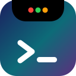
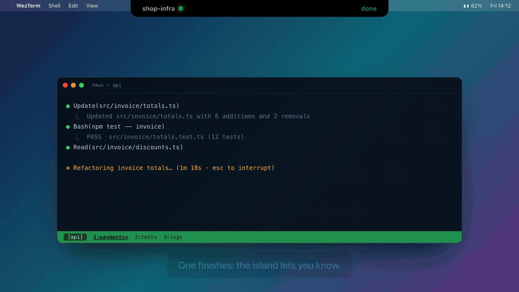
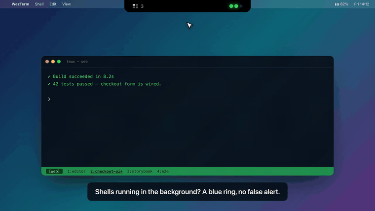

<p align="center">
  
</p>

<h1 align="center">TmuxIsland</h1>

<p align="center">
  <b>The Dynamic Island for your tmux.</b><br>
  See which AI agent finished, which one needs your approval, and jump to it in <b>one click</b>.
</p>

<p align="center">
  <a href="https://kgrandemange.github.io/tmux-island/"><b>Website</b></a> ·
  <a href="https://github.com/kgrandemange/tmux-island/releases/latest"><b>Download</b></a>
</p>

<p align="center">
  
  
  
  
  
  
</p>

<p align="center">
  
</p>

<p align="center">
  
</p>

> Screenshot data is fictional (projects "shop-web", "shop-api", "shop-infra"). The interface is available in English and French and follows your system language.

## Why

You run several AI agents (Claude Code, Codex…) in different tmux windows. While they work, you are somewhere
else. When one finishes or asks for a permission, **nothing tells you**, and you waste time finding *which*
session, *which* window, *which* pane.

TmuxIsland lives around your Mac's notch (or as a pill at the top of the screen):

- **at a glance**: one dot per agent: red if it waits for you, green if it finished, orange while it works, and a
  calm **blue ring** when its turn is over but background shells or sub-agents are still running (no false "done" alert);
- **right on time**: a toast announces a finished task, with a sound, on the screen you are looking at;
- **in one click**: you land on the right tmux pane **and** the right terminal, with nothing to search for;
- **or without the mouse**: like tmux itself, everything has a keyboard shortcut (see below).

## Keyboard first, like tmux

You can reach any agent without the mouse. Global shortcuts (configurable in **Settings…**) work from any app, and once the island is
open every agent has a number:

| Shortcut | Action |
|---|---|
| `⌃⌥Space` | Open / close the island |
| `⌃⌥J` | Jump to the next agent to handle (oldest "waiting" or "done") |
| `1`–`9` | Go to agent *n* (number row or keypad; on AZERTY no Shift needed) |
| `J` / `F` / `Esc` | Next to handle / focus mode / close |

## Built for tmux, not for a terminal

TmuxIsland doesn't hook into any terminal: it reads **tmux itself**. Everything it knows comes from
`tmux list-panes`, `capture-pane` and `list-clients`, and everything it does goes through `select-window`,
`select-pane`, `switch-client` and `send-keys`. The result: it works with **any terminal** (WezTerm, Ghostty,
iTerm2, kitty, Alacritty, Terminal.app…), whether your sessions are local, long-lived or detached.

| What happens | On the tmux side |
|---|---|
| You click an agent | `select-window` + `select-pane` + `switch-client` on the right client, then the terminal comes to the front |
| The session is displayed nowhere | a terminal opens and runs `tmux attach-session -t =session` |
| Several terminals are open | the client already showing the target session is preferred |
| Approve a permission, reply | `send-keys` into the agent's pane |
| Peek on hover | `capture-pane` (the last 10 real lines) |
| Several tmux servers (`-L`, `-S`) | every socket is discovered and followed |

## Features

<table>
<tr>
<td width="50%"><br><b>Always there, never in the way.</b> One dot per agent around the notch, the session count on the left.</td>
<td width="50%"><br><b>A clickable toast</b> when an agent finishes or waits. One click and you're there.</td>
</tr>
</table>

- **Real approval choices**: for a waiting agent, the options of the permission menu read from the screen
  ("1 · Yes", "2 · Yes, always", "3 · No"…) become buttons. No more window switching.
- **Pane preview on hover**: the last lines of the agent, without leaving what you're doing.
- **Context gauge** (Claude Code): how full each session's context window is.
- **History of finishes**: find the agent you missed, even after dismissing it.
- **Next agent to handle** (`⌃⌥J`): jumps straight to the oldest "done" or "waiting" agent.
- **Focus mode** (`⌃⌥F`): no sound, no toast; only the dots remain.
- **Follow the active screen**: the island and its alerts come to where your cursor is (multi-display).
- **Auto-acknowledge**: a "done" disappears when you are already looking at the pane.
- **All your tmux sessions** at a glance, with full window names.

<p align="center"></p>

<p align="center"></p>

## Installation

Requirements: **macOS 14 or later on Apple Silicon (M1 or newer)**, tmux 3.x. Intel Macs are not supported for now.

### Homebrew (recommended)

```bash
brew tap kgrandemange/tap
brew trust --tap kgrandemange/tap      # Homebrew asks you to trust third-party taps (once)
brew install --cask tmuxisland
```

Homebrew verifies the SHA-256 of the download and the cask removes the quarantine flag, so there is no first-launch prompt.
Update with `brew upgrade --cask tmuxisland`.

### Manual download

1. Download [`TmuxIsland.zip`](https://github.com/kgrandemange/tmux-island/releases/latest/download/TmuxIsland.zip) and unzip it.
2. Drag **TmuxIsland.app** into Applications.
3. **First launch only**: right-click the app › **Open** › **Open**. On macOS 15 or later, if the app is blocked:
   System Settings › Privacy & Security › **Open Anyway**.

To verify the download: `shasum -a 256 TmuxIsland.zip` must match the checksum published with the
[release](https://github.com/kgrandemange/tmux-island/releases).

### Why the first-launch warning, and why Apple Silicon only?

- **Notarization.** For macOS to open an app without any prompt, Apple requires it to be *notarized*, which needs a paid
  developer account (99 USD a year). TmuxIsland is a free tool, so I don't pay for that: the app is signed "ad hoc" and
  macOS asks for confirmation once. The code contains no networking calls, and the SHA-256 lets you check your download.
- **Apple Silicon only.** The app is built for arm64 (M1 and later). Supporting Intel would need a universal build; it
  isn't planned for now.

### From source

TmuxIsland is open source (MIT). It started closed, but an app that reads your terminals and sends keystrokes to
your agents should be auditable, so the code is public. Requirements: macOS 14+, the Xcode command line tools
(Swift 5.9+) and tmux.

```bash
git clone https://github.com/kgrandemange/tmux-island
cd tmux-island
./scripts/install.sh            # builds, installs into ~/Applications and launches
./scripts/install.sh --login    # same + launch automatically at login
swift test                      # unit and integration tests (tmux on a private socket)
```

TmuxIsland is a menu bar agent: no Dock icon. The menu of its icon gives access to the island,
**Settings…** (`⌘,`), focus mode and launch at login.

### Trust and verification

- No networking code at all, and the app is not sandboxed: read [SECURITY.md](SECURITY.md) for what it reads and does.
- Releases are built from the tagged source by [GitHub Actions](.github/workflows/release.yml), together with a
  SHA-256 checksum.
- Built with the help of Claude Code; every change goes through the test suite and a review.

Contributions are welcome: see [CONTRIBUTING.md](CONTRIBUTING.md).

### Hooks (optional)

TmuxIsland works without any setup. For an even more instant "done / waiting", you can plug hooks into Claude Code:

```bash
./scripts/install-claude-hooks.sh   # merges into ~/.claude/settings.json (a backup is made first)
```

Codex: in `~/.codex/config.toml` → `notify = ["~/.local/bin/tmux-island-hook", "codex"]`.

## Usage

| Action | Default shortcut |
|---|---|
| Open / close the island | `⌃⌥Space` (or hover the notch) |
| Jump to the next agent to handle | `⌃⌥J` |
| Focus mode | `⌃⌥F` |
| In the island: go to agent n | `1`–`9` |
| In the island: next to handle / focus / close | `J` / `F` / `Esc` |

The three global shortcuts can be changed in **Settings…** (rejected if they have no ⌃/⌥/⌘ or are already taken).
The same panel controls screen following, sounds and launch at login.

## How it detects an agent's state

In order of reliability:

1. **Official session status** (Claude Code): `~/.claude/sessions/<pid>.json` provides `busy` / `idle` / `shell` and links the
   session to its tmux pane. No setup needed. `shell` means the turn is over but background shells or sub-agents are still
   running: the island shows a calm blue ring ("in the background", with the count read from the screen) instead of
   "running", and raises no "done" alert until the agent really finishes.
2. **Hooks** (if installed): `UserPromptSubmit`, `Notification`, `Stop`…
3. **The pane's screen**: `esc to interrupt` (running), `Do you want to…` (waiting), `Interrupted` (interrupted: no
   alert). This is also how Codex, Gemini CLI, OpenCode, Aider, Amp, Cursor Agent or Goose are tracked.

A manual interruption (`Esc`) is never reported as a finished task.

## Privacy

Everything stays on your machine: **the code contains no networking calls**. TmuxIsland reads tmux, the tail of
Claude Code transcripts (for the context gauge) and the state files in `~/.claude/sessions` and
`~/.local/state/tmux-island`. It only changes your configuration if you run an install script yourself.

## Architecture

| File | Role |
|---|---|
| `TmuxService.swift` | tmux (panes, clients, capture, multiple servers), process table, hooks |
| `StateResolver.swift` / `Screen.swift` | agent state machine (a tested pure function) and screen reading |
| `AgentStore.swift` | polling, FSEvents, alerts, history |
| `ClaudeUsage.swift` | Claude Code sessions and context gauge |
| `FocusService.swift` / `TerminalLauncher.swift` | jump to a pane, bring the terminal forward, reattach |
| `IslandController.swift` / `IslandView.swift` | non-activating window on the notch, hover, SwiftUI interface |
| `Shortcuts.swift` / `SettingsView.swift` | configurable global shortcuts and settings |

## Development

```bash
swift test                                   # 43 tests: state machine, screen, approval menus, terminals
.build/release/TmuxIsland --snapshot out.png         # renders the island with your real sessions
.build/release/TmuxIsland --demo-images docs/assets  # renders the documentation images (fictional data)
```

### Demo environment (for videos and screenshots)

```bash
./scripts/demo/demo.sh start    # isolated tmux server with fictional projects and interactive fake agents
./scripts/demo/demo.sh play 10  # plays the scenario; see scripts/demo/SHOOTING.md for the shot list
./scripts/demo/demo.sh stop     # cleans up and relaunches the real app
```

The presentation video is rendered from `docs/video.html` (a scripted scene with fictional data): open it with
`?auto=0`, call `playVideo()`, record the page, then encode with ffmpeg.

The app's `--demo-server NAME` mode only shows that tmux server, keeps history in memory and never touches your
real files, so you can record without exposing real sessions.

## FAQ

**Does it work with my terminal?** Yes, since everything goes through tmux. Bringing the right *tab* to the front is
verified with WezTerm; for other terminals the app is brought forward and the right pane is selected in tmux.

**What about a Mac without a notch?** The island becomes a pill centered at the top of the screen.

**Why no dollar cost?** With a subscription it would be an API-rate estimate that matches no invoice, and it can't be
recomputed reliably from the transcripts.

## License

[MIT](LICENSE) © 2026 Kevin Grandemange.
