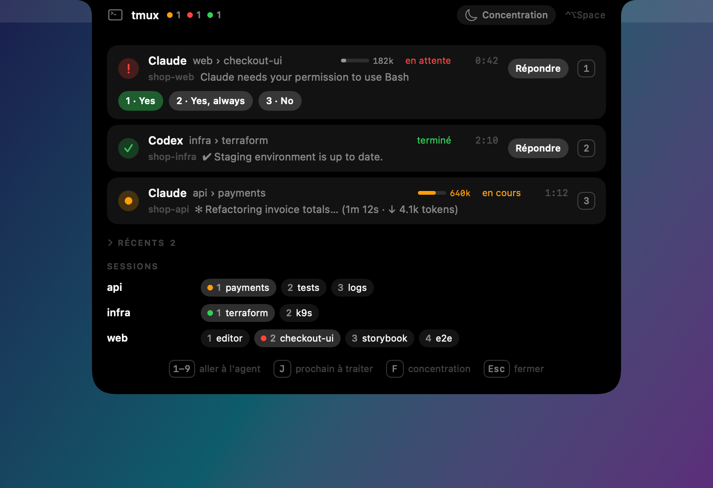
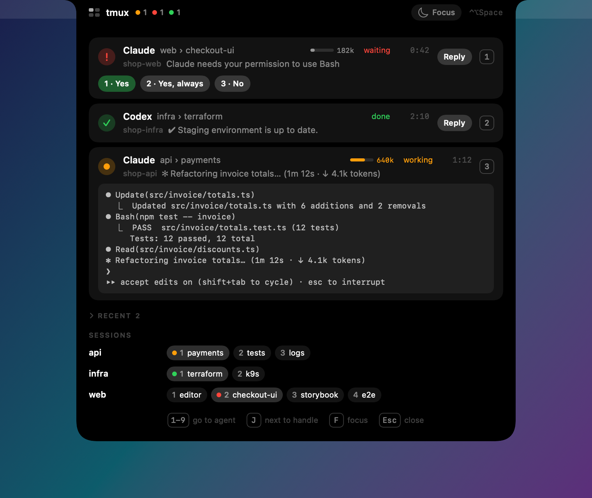

<p align="center">
  
</p>

<h1 align="center">TmuxIsland</h1>

<p align="center">
  <b>La Dynamic Island de ton tmux.</b><br>
  Sache quel agent IA a fini, lequel attend ta validation, et va dessus en <b>un clic</b>.
</p>

<p align="center">
  
  
  
  
  
  
</p>

<p align="center">
  
</p>

> Les données des captures sont fictives (projets « shop-web », « shop-api », « shop-infra »).

## Pourquoi

Tu fais tourner plusieurs agents IA (Claude Code, Codex…) dans des fenêtres tmux différentes. Pendant qu'ils
travaillent, tu es ailleurs. Quand l'un d'eux finit ou te demande une permission, **rien ne te prévient**, et tu
perds du temps à retrouver *quelle* session, *quelle* fenêtre, *quel* pane.

TmuxIsland vit autour de la notch de ton Mac (ou en pilule en haut de l'écran) :

- **d'un coup d'œil** : un point par agent, rouge s'il attend, vert s'il a fini, orange s'il travaille ;
- **à l'instant T** : un toast annonce la fin d'une tâche, avec un son, sur l'écran où tu regardes ;
- **en un clic** : tu arrives sur le bon pane tmux **et** le bon terminal, sans chercher.

## Pensé pour tmux, pas pour un terminal

TmuxIsland ne s'accroche à aucun terminal : il lit **tmux lui-même**. Tout ce qu'il sait vient de
`tmux list-panes`, `capture-pane`, `list-clients`, et tout ce qu'il fait passe par `select-window`, `select-pane`,
`switch-client` et `send-keys`. Résultat : ça marche **avec n'importe quel terminal** (WezTerm, Ghostty, iTerm2,
kitty, Alacritty, Terminal.app…), en local comme dans des sessions longues et détachées.

| Ce qui se passe | Côté tmux |
|---|---|
| Un clic sur un agent | `select-window` + `select-pane` + `switch-client` sur le bon client, puis le terminal passe devant |
| La session n'est affichée nulle part | un terminal s'ouvre et exécute `tmux attach-session -t =session` |
| Plusieurs terminaux ouverts | le client déjà affiché sur la session cible est préféré |
| Valider une permission, répondre | `send-keys` dans le pane de l'agent |
| Aperçu au survol | `capture-pane` (les 10 dernières lignes réelles) |
| Plusieurs serveurs tmux (`-L`, `-S`) | tous les sockets sont découverts et suivis |

## Fonctionnalités

<table>
<tr>
<td width="50%"><br><b>Toujours là, jamais gênant.</b> Un point par agent autour de la notch, le nombre de sessions à gauche.</td>
<td width="50%"><br><b>Un toast cliquable</b> quand un agent finit ou attend. Un clic et tu y es.</td>
</tr>
</table>

- **Choix de validation réels** : pour un agent en attente, les options du menu lues à l'écran (« 1 · Yes »,
  « 2 · Yes, always », « 3 · No »…) deviennent des boutons. Plus besoin de changer de fenêtre.
- **Aperçu du pane au survol** : les dernières lignes de l'agent, sans quitter ce que tu fais.
- **Jauge de contexte** (Claude Code) : où en est la fenêtre de contexte de chaque session.
- **Historique des fins** : retrouve l'agent que tu as raté, même après l'avoir acquitté.
- **Prochain agent à traiter** (`⌃⌥J`) : saute directement au plus ancien « terminé » ou « en attente ».
- **Mode concentration** (`⌃⌥F`) : plus de son ni de toast, seuls les points restent.
- **Suivre l'écran actif** : l'île et les alertes viennent là où se trouve ton curseur (multi-écrans).
- **Auto-acquittement** : un « terminé » disparaît quand tu regardes déjà le pane.
- **Toutes tes sessions tmux** en un coup d'œil, avec les noms de fenêtres en entier.

<p align="center"></p>

## Installation

Prérequis : macOS 14 ou plus récent, tmux 3.x. Pour construire depuis les sources : les outils en ligne de commande
Xcode (`xcode-select --install`).

```bash
git clone <ce dépôt> && cd tmux-island
./scripts/install.sh            # construit, installe dans ~/Applications et lance
./scripts/install.sh --login    # idem + lancement automatique à la connexion
```

TmuxIsland est un agent de barre de menus : pas d'icône dans le Dock. Le menu de l'icône donne accès à
l'île, aux **Réglages…** (`⌘,`), au mode concentration et au lancement à la connexion.

<details>
<summary><b>Archive prête à distribuer (<code>.zip</code>)</b></summary>

```bash
./scripts/package.sh            # build/TmuxIsland-<version>.zip + empreinte SHA-256
```

L'app est signée « ad hoc » (pas de compte développeur Apple) : au premier lancement, **clic droit › Ouvrir**
(ou `xattr -dr com.apple.quarantine TmuxIsland.app`).
</details>

### Hooks (optionnels)

TmuxIsland fonctionne sans rien configurer. Pour un « terminé / en attente » encore plus instantané, tu peux
brancher des hooks sur Claude Code :

```bash
./scripts/install-claude-hooks.sh   # fusionne dans ~/.claude/settings.json (sauvegarde créée avant)
```

Codex : dans `~/.codex/config.toml` → `notify = ["~/.local/bin/tmux-island-hook", "codex"]`.

## Utilisation

| Action | Raccourci par défaut |
|---|---|
| Ouvrir / fermer l'île | `⌃⌥Space` (ou survol de la notch) |
| Aller au prochain agent à traiter | `⌃⌥J` |
| Mode concentration | `⌃⌥F` |
| Dans l'île : aller à l'agent n | `1`–`9` |
| Dans l'île : prochain à traiter / concentration / fermer | `J` / `F` / `Esc` |

Les trois raccourcis globaux sont modifiables dans **Réglages…** (refus s'ils n'ont pas de ⌃/⌥/⌘ ou s'ils sont déjà pris).
Le même panneau règle le suivi d'écran, les sons et le lancement à la connexion.

## Comment il détecte l'état d'un agent

Par ordre de fiabilité :

1. **Statut officiel de la session** (Claude Code) : `~/.claude/sessions/<pid>.json` donne `busy` / `idle` et relie la
   session à son pane tmux. Aucune config nécessaire.
2. **Hooks** (si installés) : `UserPromptSubmit`, `Notification`, `Stop`…
3. **Écran du pane** : `esc to interrupt` (en cours), `Do you want to…` (en attente), `Interrupted` (interrompu : pas
   d'alerte). C'est aussi ce qui permet de suivre Codex, Gemini CLI, OpenCode, Aider, Amp, Cursor Agent ou Goose.

Une interruption à la main (`Esc`) n'est jamais signalée comme une fin de tâche.

## Confidentialité

Tout reste sur ta machine : **le code ne contient aucun appel réseau**. TmuxIsland lit tmux, la fin des transcripts
Claude Code (pour la jauge de contexte) et les fichiers d'état de `~/.claude/sessions` et
`~/.local/state/tmux-island`. Il ne modifie ta configuration que si tu lances toi-même un script d'installation.

## Architecture

| Fichier | Rôle |
|---|---|
| `TmuxService.swift` | tmux (panes, clients, capture, serveurs multiples), table des processus, hooks |
| `StateResolver.swift` / `Screen.swift` | machine à états des agents (fonction pure testée) et lecture de l'écran |
| `AgentStore.swift` | relevés, FSEvents, alertes, historique |
| `ClaudeUsage.swift` | sessions et jauge de contexte de Claude Code |
| `FocusService.swift` / `TerminalLauncher.swift` | saut vers le pane, activation du terminal, ré-attache |
| `IslandController.swift` / `IslandView.swift` | fenêtre non activante sur la notch, survol, interface SwiftUI |
| `Shortcuts.swift` / `SettingsView.swift` | raccourcis globaux configurables et réglages |

## Développement

```bash
swift test                                   # 43 tests : machine à états, écran, menus de validation, terminaux
.build/release/TmuxIsland --snapshot out.png         # rend l'île avec tes vraies sessions
.build/release/TmuxIsland --demo-images docs/assets  # rend les captures de la doc (données fictives)
```

## FAQ

**Ça marche avec mon terminal ?** Oui, puisque tout passe par tmux. La mise au premier plan du bon *onglet* est
vérifiée avec WezTerm ; pour les autres terminaux, l'application est amenée devant et le bon pane est sélectionné
dans tmux.

**Et sur un Mac sans notch ?** L'île devient une pilule centrée en haut de l'écran.

**Pourquoi pas de coût en dollars ?** Avec un abonnement, ce serait une estimation au tarif API qui ne
correspond à aucune facture, et elle ne peut pas être recalculée fiablement depuis les transcripts.

## Licence

Gratuit, **non open source** : voir [LICENSE](LICENSE). Usage libre ; modification et redistribution interdites sans
autorisation.
